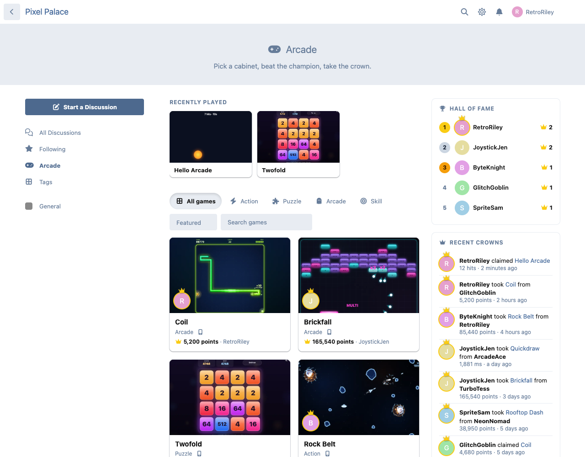
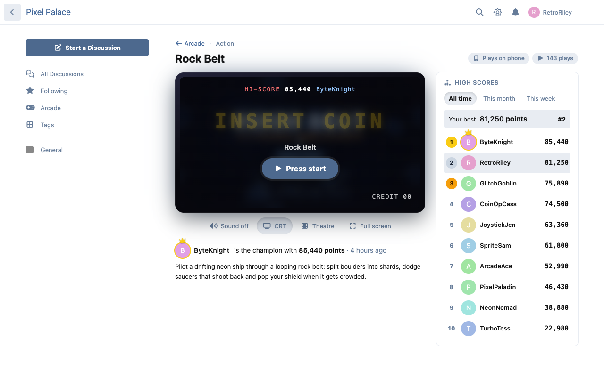
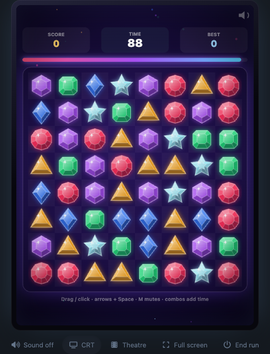
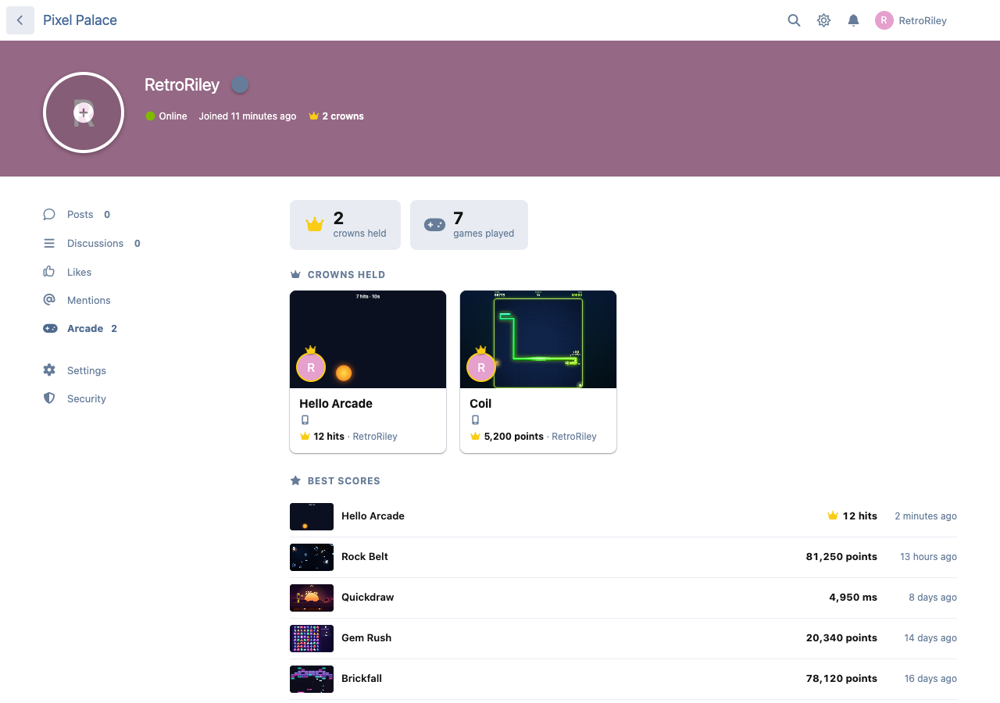
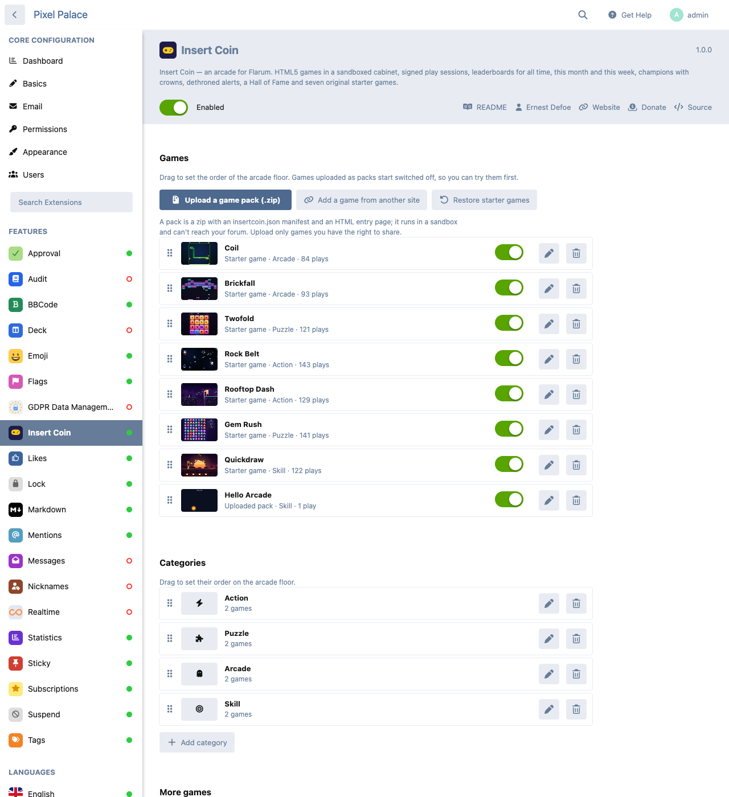
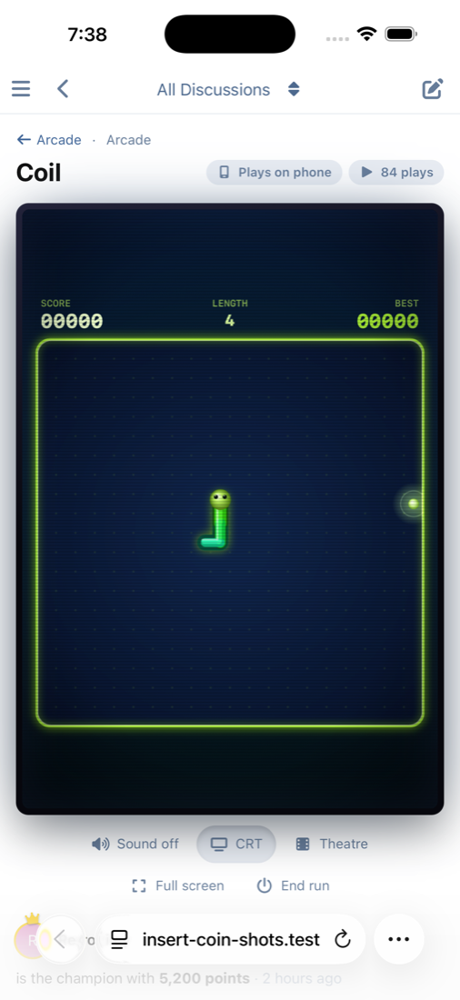

# Insert Coin — an arcade for Flarum

 

The forum arcade is back. In the spirit of the old IBArcade and ibProArcade, rebuilt for today: HTML5 games in a glowing cabinet, champions with crowns, high-score tables and "you've been dethroned" alerts. Seven original games come with it, so it's fun the minute you switch it on.



## Features

- **Seven original games**, written for Insert Coin, with procedural art and synthesised sound:
  - Coil (snake)
  - Brickfall (brick-breaker)
  - Twofold (a 2048-style merge puzzle)
  - Rock Belt (an asteroids-style shooter)
  - Rooftop Dash (an endless runner)
  - Gem Rush (match-3 against the clock)
  - Quickdraw (a reaction duel, where the lowest time wins)

  Every one plays on a phone with touch and on a desktop with the keyboard, and each has its own sound switch.
- **The cabinet.** Each game sits in a framed screen with CRT glass and scanlines (one switch turns them off). The attract screen shows the HI-SCORE and its holder, with a blinking *Insert coin* and *Press start*. Theatre mode dims the page, and full screen fills the display.
- **Champions and crowns.** Every game has a champion, with their avatar and a crown on the game's card. Members get an *Arcade* tab on their profile with their crowns and best scores, and a crown count on their user card.
- **High scores** for all time, this month and this week. Your best and your rank update the moment a run ends.
- **Score moments.** A personal best gets a toast; taking a crown gets a celebration with confetti, which stays still for anyone who asks their device for reduced motion.
- **Dethroned alerts:** "You've been dethroned on Rock Belt by RetroRiley", as a notification and by email.
- **The arcade floor:** big cover art, categories, search, recently played, a Hall of Fame (most crowns held) and the latest crowns.
- **Fair play:**
  - Every run needs a signed, single-use session from the server.
  - Each game has a shortest and longest honest run and a score ceiling.
  - Scores far beyond the record are held for a moderator.
  - Games can require a moderator to approve every new crown.
  - Starting runs and posting scores are rate-limited.
- **Moderation:** a review queue, wiping a game's scores or one member's, and a ban from the arcade.
- **Add more games:**
  - Upload any HTML5 game as a zip pack. Packs are checked for path tricks, zip bombs and anything a server or browser would run.
  - Or add a game hosted on another site.
  - [The guide](docs/MAKING-GAMES.md) covers where to find games and the three lines that put their scores on the boards.
- **Safe by design:** every game runs in a sandbox. It can't read your members' cookies, call your forum's API or touch the page around it.
- **Optional extras:**
  - Points for taking a crown through [FoF Gamification](https://github.com/FriendsOfFlarum/gamification).
  - Live leaderboards with [Flarum Realtime](https://flarum.org).
  - A *Recent crowns* widget for [Bespoke](https://ernestdefoe.online) and [FoF Forum Widgets](https://github.com/FriendsOfFlarum/forum-widgets-core). In FoF Forum Widgets, drag it into a section of the layout editor; it shows nowhere until you do.
- **Built on Flarum's own layout and colours,** so it fits the default theme, dark mode and your theme. Translatable throughout.
- **Light:** it adds about 4 KB (gzipped) to the JavaScript every page loads. Everything else, styles included, loads only on the arcade's pages.

## Screenshots

| The cabinet | Playing |
| --- | --- |
|  |  |

| A new champion | A member's arcade tab |
| --- | --- |
|  |  |

| Managing games | On a phone |
| --- | --- |
|  |  |

## Installation

```sh
composer require ernestdefoe/insert-coin
```

Then enable **Insert Coin** in the admin panel. The arcade is at `/arcade`, with a link in the forum's sidebar.

## Updating

```sh
composer update ernestdefoe/insert-coin
php flarum migrate
php flarum assets:publish
php flarum cache:clear
```

## Permissions

| Permission | Default |
| --- | --- |
| Play arcade games | Everyone, guests included |
| Post arcade scores | Members |
| Moderate the arcade (review queue, wipe scores, ban) | Moderators |

Adding, editing and uploading games is for admins.

## More games

Insert Coin ships no third-party games. Old arcade games were mostly shared without clear licences. What you add is your call; the guide points to places where games come with a licence:

- **[Getting more games into Insert Coin](docs/MAKING-GAMES.md):**
  - where to find HTML5 games (js13kGames, GitHub, itch.io);
  - how to adapt one;
  - the pack format;
  - the sandbox;
  - games hosted elsewhere.
- **[An example pack](examples/hello-arcade)** to copy: zip the folder and upload it.
- **The score SDK** is [`assets/sdk/insertcoin.js`](assets/sdk/insertcoin.js). The arcade adds it to every game it serves.

Flash games (IBArcade, ibProArcade and v3arcade packs, through Ruffle) are planned as a separate, optional add-on. Insert Coin already has the seam for it: `ErnestDefoe\InsertCoin\Extend\GameSource` registers a new kind of game and a reader for its packs.

## Points

FoF Gamification recounts a member's points from their votes, so points from another extension need its point-grants feature. With a FoF Gamification version that has it, set *Points for taking a crown* in the admin page.

## Links

- [Source code on GitHub](https://github.com/ernestdefoe/insert-coin)
- [Report an issue](https://github.com/ernestdefoe/insert-coin/issues)
- ☕ [Buy me a coffee](https://buymeacoffee.com/ernestdefoe)
